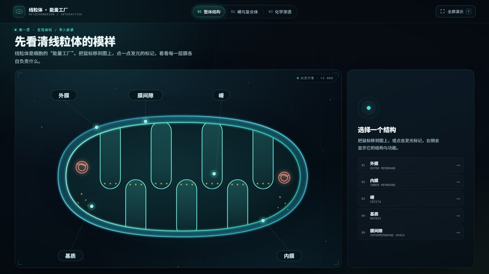
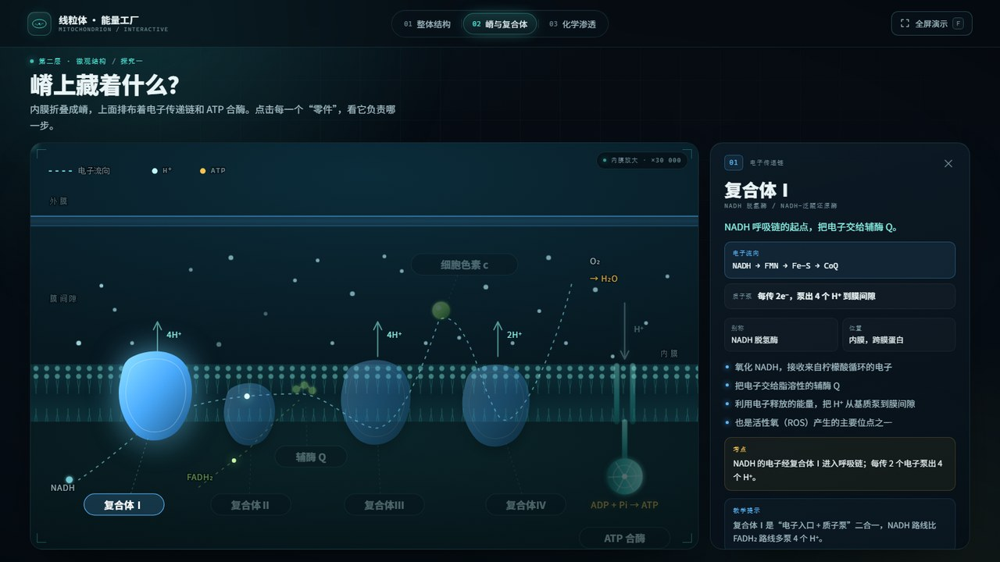
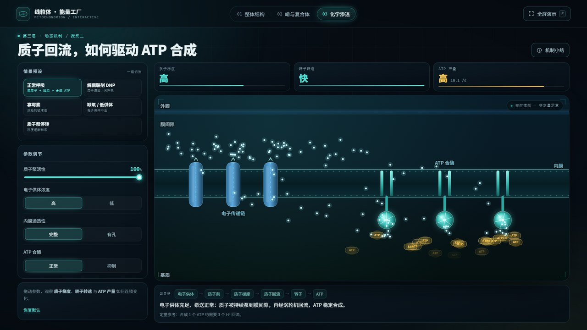

# 线粒体 · 能量工厂

面向高中生物课堂的**交互式教学网页**：从整体结构 → 嵴上的电子传递链 → 化学渗透实时模拟，三层递进，适合投屏讲课。

纯 HTML / CSS / JavaScript 编写，**没有构建步骤、没有外部依赖、不需要联网**。双击 `index.html` 就能用，也可以直接部署到 GitHub Pages。





---

## 三个层级

| 层级 | 内容 | 教学定位 |
|---|---|---|
| **01 整体结构** | 代码绘制的线粒体剖面，标注外膜、内膜、嵴、基质、膜间隙；点击发光标记查看知识卡 | 导入新课，建立"结构与功能相适应" |
| **02 嵴与复合体** | 内膜磷脂双分子层放大，含复合体Ⅰ/Ⅱ/Ⅲ/Ⅳ、辅酶 Q、细胞色素 c、ATP 合酶；电子沿呼吸链流动 | 探究一，看清电子传递链的"零件" |
| **03 化学渗透** | Canvas 实时模拟：质子泵、质子梯度、涡轮机旋转、ATP 生成；四个参数 + 因果链高亮 + 情景预设 | 探究二（核心难点），突破"质子回流驱动 ATP 合成" |

推荐路径：首页点 **嵴** → 第二层点 **ATP 合酶** → 第三层调参数。顶部导航也可以随时跨层跳转。

---

## 快速开始

1. 用 **Chrome / Edge** 打开 `index.html`，点右上角"全屏演示"（或按 `F`）。
2. 建议分辨率 1920×1080 或 1366×768；页面已针对投影做字号与布局适配。
3. 不需要安装任何东西，断网也能正常演示。

### 快捷键

| 按键 | 作用 |
|---|---|
| `1` / `2` / `3` | 切换到第 1 / 2 / 3 层 |
| `←` / `→` | 上一层 / 下一层 |
| `F` | 进入或退出全屏 |
| `Esc` | 关闭"机制小结"弹窗 |

---

## 部署到 GitHub Pages（生成链接发给同学）

网站是纯静态文件，`index.html` 就是入口。

### 方法一：网页上传

1. 在 GitHub 新建一个 **Public** 仓库（例如 `mitochondrion`）。
2. 打开仓库 → **Add file → Upload files**，上传以下内容：
   - `index.html`
   - `css/` 整个文件夹
   - `js/` 整个文件夹
   - `assets/`（README 预览图，可选）
   - `.nojekyll`、`README.md`
3. **Commit changes**。
4. 进入 **Settings → Pages**：
   - **Source** 选 `Deploy from a branch`
   - **Branch** 选 `main`（或 `master`），目录选 `/ (root)`
   - 点 **Save**
5. 等 1–2 分钟，访问：
   `https://<你的用户名>.github.io/<仓库名>/`

### 方法二：命令行

```bash
git init
git add .
git commit -m "线粒体交互教学网页"
git branch -M main
git remote add origin https://github.com/<用户名>/<仓库名>.git
git push -u origin main
```

然后在仓库 **Settings → Pages** 里按上面的方式开启即可。

> 不需要上传的内容：`整体思路.docx`、`1.jpg`、`DeepSeek对话记录.txt`、`聊天记录.txt`。它们是备课参考资料，网页本身不依赖。

---

## 目录结构

```
.
├─ index.html            页面骨架（三层视图 + 顶部导航 + 机制小结弹窗）
├─ css/
│  └─ style.css          全部样式与设计变量
├─ js/
│  ├─ content.js         所有知识卡文案（改文字只改这里）
│  ├─ level1.js          第一层：线粒体剖面 SVG + 热区
│  ├─ level2.js          第二层：电子传递链 SVG + 热区
│  ├─ level3.js          第三层：Canvas 模拟器 + 参数控制
│  └─ app.js             导航、键盘、全屏、知识卡渲染
├─ assets/               README 预览图（网页不使用）
├─ README.md
└─ .nojekyll             让 GitHub Pages 原样提供静态文件
```

---

## 二次修改指南

### 1. 改文案 / 加知识卡

所有文字集中在 `js/content.js`：

```js
MITO.L1 = [ { id, index, name, en, tone, tagline, desc, facts, exam, tip, cta }, ... ]
MITO.L2 = [ { id, index, name, en, tone, tagline, electron, pump, facts, points, exam, tip, cta }, ... ]
MITO.L3 = { presets: [...], notes: {...} }
```

- `tone` 控制强调色：`teal` / `blue` / `gold` / `lime` / `ice`
- `facts` 是 `[标签, 内容]` 数组，展示为 2 列信息块
- `cta` 可选，`{ label: '按钮文字', view: 2 }`，点击跳到指定层
- 第三层的 `notes` 是每个情景下方的"联系实际"

> 只改文案不需要动 SVG / Canvas。

### 2. 改颜色和字号

`css/style.css` 顶部 `:root` 里集中了设计变量：

```css
--bg: #060b11;      /* 背景 */
--teal: #4de0d2;    /* 主色：膜、质子、转子 */
--blue: #5ab8ff;    /* 复合体 */
--gold: #f5c451;    /* ATP、提示 */
--coral: #ff8b72;   /* 断点、漏回 */
```

### 3. 改模拟参数

`js/level3.js` 顶部：

```js
const PUMP_K = 30;      // 满泵、满供体时每秒泵出的质子数
const RETURN_K = 55;    // 回流系数（决定稳态梯度）
const LEAK_K = 220;     // 内膜有孔时的漏回系数
const HILL = 1.5;       // 梯度对回流速度的非线性
const POOL = 130;       // 质子总数
```

修改后刷新页面即可。第三层是**规则模型**，数值只表达因果方向与相对强弱，不是定量仿真。

### 4. 改热区位置

- 第一层：`js/level1.js` 里的 `PINS`，每项有 `dot`（圆点坐标）、`chip`（标签中心）、`leader`（引线起止），坐标系为 `1000 × 640`。
- 第二层：`js/level2.js` 的 `complexGroup({...})` 调用，`x / y` 是复合体中心，`tag` 是标签位置。

### 5. 改第三层情景预设

在 `js/content.js` 的 `MITO.L3.presets` 中增删对象：

```js
{ id: 'normal', name: '正常呼吸', sub: '泵质子 → 回流 → 合成 ATP',
  state: { pump: 100, donor: 'high', leak: 'intact', synthase: 'normal' } }
```

可用的 `donor`: `high` / `low`；`leak`: `intact` / `leaky`；`synthase`: `normal` / `inhibited`；`pump`: 0–100。

---

## 课堂使用建议（约 20 分钟）

1. **导入（3 分钟）**：停在第一层，问"细胞里为什么需要一个专门的'能量工厂'？"依次点外膜、内膜、嵴、基质、膜间隙，引导学生说出"结构如何服务于功能"。
2. **探究一（6 分钟）**：点"嵴"进入第二层。让学生从复合体Ⅰ数到Ⅳ，回答"每传 2 个电子，泵出几个 H⁺？"（Ⅰ=4、Ⅲ=4、Ⅳ=2，可记成"4-4-2 阵型"）。强调复合体Ⅱ**不泵质子**，所以 FADH₂ 产 ATP 更少。
3. **探究二（8 分钟）**：进入第三层，先看"正常呼吸"，再依次点"解偶联剂 DNP""寡霉素""缺氧/低供体"。每次停 5–10 秒，让学生看**因果链**哪一环先变红：
   - 解偶联剂 → 质子从孔漏回，梯度被短路，只产热；
   - 寡霉素 → 涡轮机被堵，梯度越积越高，但没有 ATP；
   - 缺氧 → 供体不足，泵出的质子变少，梯度下降。
4. **小结（3 分钟）**：点"机制小结"，用水力发电的类比收束：水位差（梯度）→ 水流（H⁺）→ 涡轮（转子）→ 发电（ATP）。电子传递链并不直接制造 ATP，中间用质子梯度"存"了一次能量。

---

## 模型说明与知识边界

- 第三层是**定性/半定量示意**，用于展示因果链，不是真实的生化动力学仿真。
- 参考数值采用高中教材的常见口径：每传 2e⁻，复合体Ⅰ、Ⅲ 各泵 4 个 H⁺，复合体Ⅳ泵 2 个；约 3 个 H⁺ 回流合成 1 个 ATP。
- 解偶联剂（DNP）、寡霉素、缺氧等情景用于课堂对比，剂量与真实药理学无关。
- 页面中的线粒体是 **2D 剖面示意图**（带透视与发光效果），不是可旋转的 3D 模型；如果后续要做真 3D，可以把 SVG 舞台替换为 Three.js 场景，知识卡与模拟层可以复用。

## 浏览器兼容

- Chrome / Edge 100+：推荐，动画最完整
- Firefox 100+：可用
- Safari 15.4+：可用（`<dialog>` 需 15.4+）

页面不使用 CDN、外部字体或图片，所有图形由 SVG / Canvas 实时绘制，离线可用。

---

知识点参考同学提供的《整体思路》文档与人教版高中生物必修 1；页面代码与图形为原创实现。
